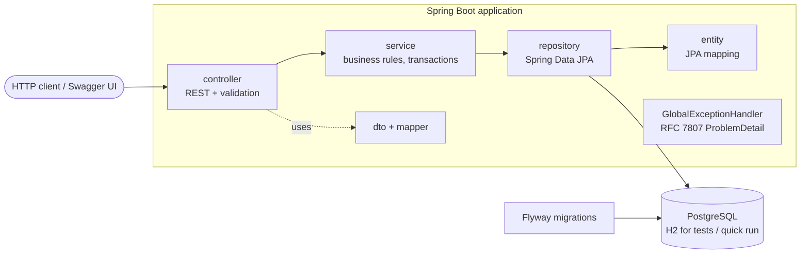
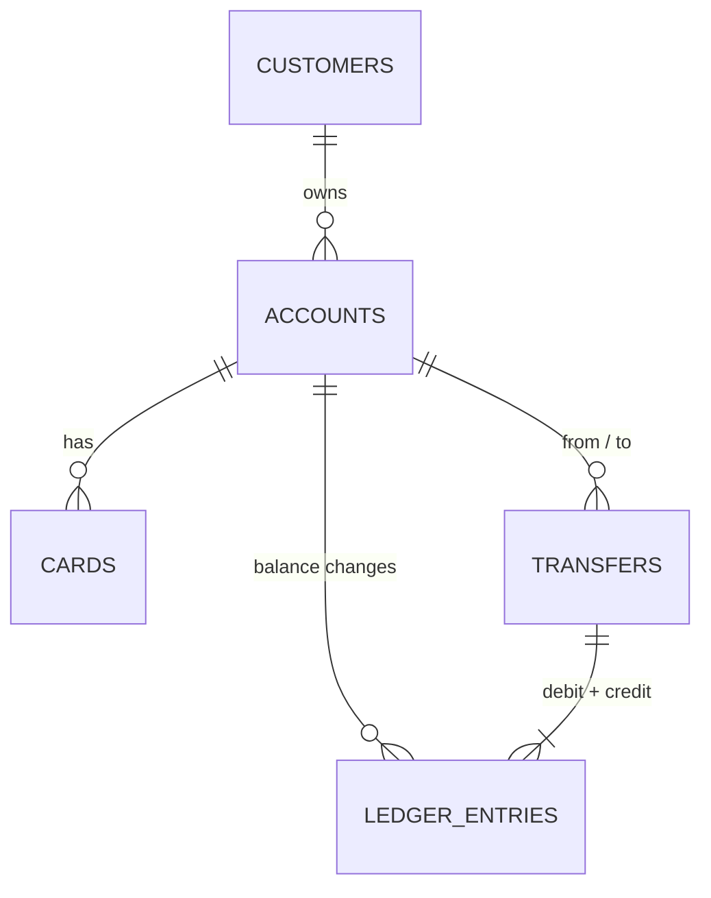

# Bank Service

[](https://github.com/ilya-34/bank-service/actions/workflows/ci.yml)

A small backend for a banking domain, written as a portfolio project: customers, accounts, cards,
money transfers between accounts and a ledger of every balance change. REST API on Java 17 and
Spring Boot 3, PostgreSQL schema managed by Flyway, OpenAPI docs via Swagger UI.

> **This is an educational demo, not a real banking system.** See [Scope](#scope--not-production).

## Stack

Java 17 · Spring Boot 3.5 (Web, Validation, Data JPA / Hibernate, Actuator) · PostgreSQL · Flyway ·
springdoc-openapi (Swagger UI) · JUnit 5 · Mockito · Spring Test / MockMvc · H2 (local run and tests) ·
Maven Wrapper · Docker Compose · GitHub Actions. No Lombok: DTOs are records, entities are plain classes.

## Architecture



Packages: `controller` → `service` → `repository` → `entity`; `dto` and `mapper` (hand-written) are kept
separate from entities; `exception` holds the domain exceptions and the global error handler.

### Data model



The schema (`src/main/resources/db/migration/V1__init_schema.sql`) has foreign keys, indexes,
`CHECK (balance >= 0)`, positive-amount checks, a currency/status whitelist, a unique email, and a unique
idempotency key on transfers.

## Running

You need JDK 17 or newer (the build is tested on 17 and 25). Everything goes through the Maven Wrapper.

### Quick start (in-memory H2, no external services)

```bash
./mvnw spring-boot:run
```

The app starts on <http://localhost:8080> with the `h2` profile (the default). Data disappears on restart.
Swagger UI: <http://localhost:8080/swagger-ui.html> · OpenAPI JSON: <http://localhost:8080/v3/api-docs>.

### With PostgreSQL via Docker Compose

```bash
cp .env.example .env          # then set POSTGRES_PASSWORD
docker compose up --build
```

This starts PostgreSQL 16 and the application (profile `dev`). Credentials come only from `.env` /
environment variables; nothing secret is committed. To run only the database and start the app from the IDE or Maven:

```bash
docker compose up -d postgres
DB_PASSWORD=<your POSTGRES_PASSWORD> SPRING_PROFILES_ACTIVE=dev ./mvnw spring-boot:run
```

Profiles: `h2` (default, in-memory), `dev` (PostgreSQL, defaults for local use, debug logging),
`prod` (PostgreSQL, all settings required from the environment, Swagger disabled unless `SWAGGER_ENABLED=true`).

### Tests

```bash
./mvnw verify
```

85 test executions (including 20 repeated runs of a randomized card-number test) with no external
services: unit tests use Mockito, API tests use `@SpringBootTest` + MockMvc against in-memory H2 with the
real Flyway migrations. The same command runs in GitHub Actions on Java 17.

## API

Base path `/api/v1`. Full interactive docs are in Swagger UI.

| Method | Path | Description |
|---|---|---|
| POST | `/customers` | Create a customer (name, email, phone are validated) |
| GET | `/customers` | List customers, paginated (`page`, `size`) |
| GET | `/customers/{id}` | Get a customer |
| PUT | `/customers/{id}` | Update a customer |
| POST | `/customers/{customerId}/accounts` | Open an account (`USD`, `EUR`, `BYN`) |
| GET | `/customers/{customerId}/accounts` | List a customer's accounts |
| GET | `/accounts/{id}` | Get an account |
| GET | `/accounts/{id}/balance` | Current balance |
| POST | `/accounts/{id}/deposit` | Demo top-up (writes a ledger entry) |
| POST | `/accounts/{id}/block` · `/unblock` · `/close` | Change account status (close needs a zero balance) |
| GET | `/accounts/{id}/transactions` | Ledger history, newest first, paginated |
| POST | `/accounts/{accountId}/cards` | Issue a test card (masked number only) |
| GET | `/accounts/{accountId}/cards` | List cards of an account |
| GET | `/cards/{id}` | Get a card |
| POST | `/cards/{id}/block` · `/unblock` | Block / unblock a card |
| POST | `/transfers` | Transfer between accounts (requires `Idempotency-Key` header) |
| GET | `/transfers/{id}` | Get a transfer |

### Error format

Errors are [RFC 7807](https://www.rfc-editor.org/rfc/rfc7807) problem details with an extra `code` field:

| Status | When | Example `code` |
|---|---|---|
| 400 | validation, malformed JSON, missing `Idempotency-Key` | `VALIDATION_ERROR` (with an `errors` list) |
| 404 | unknown customer / account / card / transfer | `NOT_FOUND` |
| 409 | duplicate email, reused idempotency key with a different body | `EMAIL_ALREADY_EXISTS`, `IDEMPOTENCY_KEY_REUSED` |
| 422 | business rule | `INSUFFICIENT_FUNDS`, `CURRENCY_MISMATCH`, `SAME_ACCOUNT`, `ACCOUNT_NOT_ACTIVE`, `ACCOUNT_NOT_EMPTY` |

### Example session (curl)

```bash
H='Content-Type: application/json'; API=http://localhost:8080/api/v1

# customer and two USD accounts (ids are returned in the responses; here 1 and 2)
curl -s -X POST $API/customers -H "$H" \
  -d '{"firstName":"Anna","lastName":"Ivanova","email":"anna@example.com","phone":"+375291234567"}'
curl -s -X POST $API/customers/1/accounts -H "$H" -d '{"currency":"USD"}'
curl -s -X POST $API/customers/1/accounts -H "$H" -d '{"currency":"USD"}'

# fund account 1 (demo top-up), then transfer 40.00 to account 2
curl -s -X POST $API/accounts/1/deposit -H "$H" -d '{"amount":100.00}'
curl -s -i -X POST $API/transfers -H "$H" -H 'Idempotency-Key: demo-1' \
  -d '{"fromAccountId":1,"toAccountId":2,"amount":40.00,"description":"Rent"}'
#   HTTP/1.1 201

# same request again with the same key: nothing moves, the original transfer is returned
curl -s -i -X POST $API/transfers -H "$H" -H 'Idempotency-Key: demo-1' \
  -d '{"fromAccountId":1,"toAccountId":2,"amount":40.00,"description":"Rent"}'
#   HTTP/1.1 200, Idempotent-Replayed: true

# not enough money
curl -s -i -X POST $API/transfers -H "$H" -H 'Idempotency-Key: demo-2' \
  -d '{"fromAccountId":1,"toAccountId":2,"amount":1000.00}'
#   HTTP/1.1 422, "code":"INSUFFICIENT_FUNDS"

curl -s $API/accounts/1/balance           # 60.00
curl -s "$API/accounts/1/transactions"    # deposit + debit, newest first
curl -s -X POST $API/accounts/1/cards     # {"maskedNumber":"**** **** **** 1234", ...}
```

## Design decisions

**Money is `BigDecimal` / `NUMERIC(19,2)`.** Binary floating point cannot represent most decimal amounts exactly.
Request amounts must be at least 0.01 with at most two decimal places (validated at the API), and comparisons use
`compareTo`, not `equals`, so `30.5` and `30.50` are the same amount.

**A transfer is one transaction.** Debit, credit, the `transfers` row and the two ledger rows commit together or
not at all (`TransferProcessor`, `@Transactional`). The ledger (`ledger_entries`) is append-only and stores the
balance after each change, so history can be checked against the current balance (a test does this).

**Concurrency: pessimistic row locks in a fixed order.** A transfer locks both account rows with
`SELECT ... FOR UPDATE`, always in ascending id order. Two opposite transfers (A→B and B→A) therefore queue on the
same first lock instead of deadlocking. Under the lock the balance check and update are race-free, and the
database `CHECK (balance >= 0)` is a last line of defense. Accounts also carry a `@Version` column (optimistic
locking) as a safety net for any code path that updates them without the row lock; a conflict maps to HTTP 409.
Concurrent tests run dozens of threads against shared accounts and check that the total is preserved, that the
balance never goes negative, that opposing transfers finish without deadlock, and that the ledger matches the
balances.

**Idempotency.** `POST /transfers` requires an `Idempotency-Key` header (up to 64 characters). The key is stored
in `transfers.idempotency_key` with a unique constraint.
- Same key, same body: the original transfer is returned (`200`, `Idempotent-Replayed: true`), no money moves.
- Same key, different body: `409 IDEMPOTENCY_KEY_REUSED`.
- Two identical requests arriving at the same moment: the key is re-checked after the account locks are taken,
  and a unique-constraint violation is caught outside the failed transaction and answered with the winning
  transfer. A test fires 12 parallel requests with one key and expects exactly one transfer.
- Failed requests (e.g. insufficient funds) are not recorded, so retrying them with the same key re-evaluates them.
- Keys are kept forever; there is no expiry job.

**Business rules.** Amounts must be positive; no transfers to the same account; no cross-currency transfers
(there is no exchange-rate logic, so they are rejected with 422); both accounts must be `ACTIVE`; an account can
only be closed when its balance is zero.

**Cards.** A test card number (fixed `400000` prefix, valid Luhn digit) is generated, only the masked form
`**** **** **** 1234` is stored and returned, and the full number is discarded. Cards expire at the end of the
month four years after issue.

**Errors.** One `@RestControllerAdvice` turns every failure into a `ProblemDetail` with a stable `code`;
unexpected exceptions return a generic 500 without internals.

## Scope / not production

This is a learning and portfolio project. It deliberately leaves out what a real system would need:

- No authentication or authorization: every endpoint is open, and the API does not check who owns an account.
- No real payments, card networks, KYC/AML, fees, limits, or currency conversion.
- `POST /accounts/{id}/deposit` exists only to make the demo usable.
- Card numbers are fake and not stored; cards are not used for any operation.
- Not load-tested; no metrics beyond Actuator health, no audit trail beyond the ledger, no rate limiting.
- The Docker Compose and PostgreSQL setup has not been exercised in CI (tests run on H2 in PostgreSQL mode).

### Roadmap ideas

- Spring Security with JWT and ownership checks on accounts.
- Testcontainers tests against real PostgreSQL in CI.
- Transactional outbox for publishing transfer events.
- Micrometer metrics and structured logging.
- Idempotency-key expiry and request fingerprinting.

## License

[MIT](LICENSE) © Ilya Kolesnik
